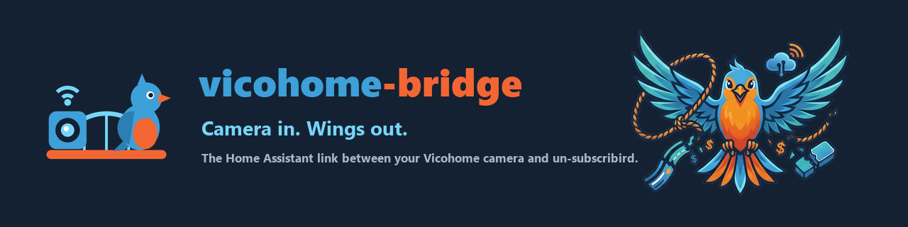

# vicohome-bridge brand

A sibling of the [un-subscribird](https://github.com/jbuck2005/unsubscribird) brand
(*No Strings. Just Wings.*). un-subscribird is the bird: local AI bird identification you own.
vicohome-bridge is the link that gets your Vicohome camera's visits into Home Assistant, where
un-subscribird can use them. The mark says that literally: a camera and the bird on either
side of a bridge.



## Name and tagline
- **Wordmark:** `vicohome` in Tech Sky Blue + `-bridge` in Liberation Orange, set in one heavy
  weight. It mirrors un-subscribird's split (`un-subscri` / `bird`): orange marks the part that
  breaks free.
- **Tagline:** *Camera in. Wings out.*
- The add-on's store name stays **Vicohome MQTT Bridge**, a plain description of what it does.
- This project has no connection with Vicohome. Never use Vicohome's logo, and never word or
  draw anything to suggest it's an official Vicohome product.

## Palette (shared with un-subscribird)
| Name | Hex | Use here |
|---|---|---|
| Abyss Blue | `#142132` | Tile and banner background |
| Tech Sky Blue | `#3EA0D8` | Camera, bird, `vicohome` |
| Liberation Orange | `#F36633` | Bridge deck, belly and beak, `-bridge` |
| Cyan Highlight | `#75D6F9` | Signal arcs, bridge cables, lens, tagline |

Two tints for small details: wing `#2B7FB4`, secondary text `#A9B8C8`.

## Mark
- **Icon** ([`vicohome_mqtt/icon.png`](vicohome_mqtt/icon.png), 128x128): the mark on an Abyss
  Blue rounded tile. The add-on store shows it in its list.
- **Logo** ([`vicohome_mqtt/logo.png`](vicohome_mqtt/logo.png), 250x100): mark, wordmark and tagline
  on an Abyss Blue box, so it reads on HA's light and dark themes alike. Shown on the add-on page.
- **Banner** ([`images/banner.png`](images/banner.png)): README header, with the un-subscribird
  mascot on the far bank.
- Leave clear space around the mark of at least the camera's width.

## Type and voice
Fonts and tone follow un-subscribird: Montserrat ExtraBold (or Nunito Black) for headings,
Inter for body text, Fira Code for code. Clever but clear, rebellious but professional, written
for the maker community. Use bird metaphors sparingly, and never at the cost of clarity.

## Regenerating
All three images are drawn by [`images/make_brand.py`](images/make_brand.py) (needs Pillow):

```
python images/make_brand.py vicohome_mqtt images/banner.png <un-subscribird logo png>
```

It uses Montserrat ExtraBold and Inter when they're installed, otherwise Segoe UI Black and
Segoe UI Bold (the current images use Segoe UI).
